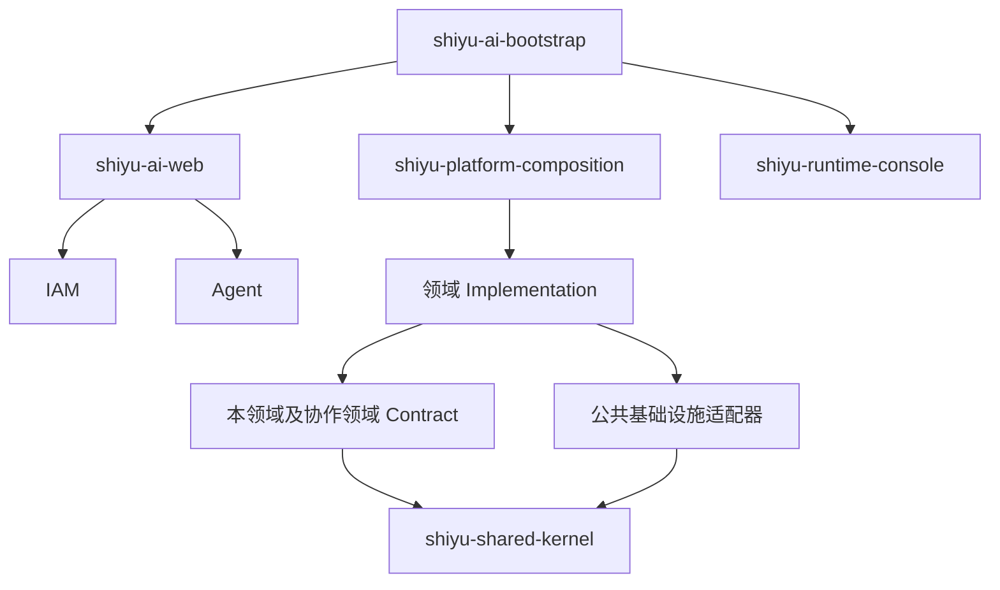

# 后端架构与代码静态审查

**审查日期：** 2026-10-22

**审查范围：** `shiyu-ai` 后端 Maven reactor 及其生产源码、架构规则和相关测试源码。

**基线提交：** `a49c0c61`
**方法：** 静态源码与依赖审查；未修改代码，未运行构建、测试或服务。

## 结论摘要

后端采用模块化单体，平台领域以 Contract 和 Implementation 分层，业务由启动模块装配，公共基础设施提供 Web、持久化、线程、存储和向量能力。对 POM 依赖及 Java import 的静态扫描未发现模块依赖环、跨领域 Implementation 直接引用或 Contract 引入架构规则所禁止的框架依赖。

本轮确认 **3 项 P1、6 项 P2**。优先关注生成取消与配额生命周期、模型故障状态恢复，以及检索和考试历史在数据增长后的资源成本。没有足够证据支持 P0 级结论。

## 架构与依赖方向

Maven reactor 包含根 POM 和 31 个子模块。生产代码共 1,276 个 Java 文件，测试源码共 343 个 Java 文件。以下依赖图概括主要边界，不展示每个 Maven 依赖：



- `shiyu-ai-bootstrap` 是应用启动入口；`shiyu-platform-composition` 负责平台装配和跨领域桥接。
- IAM、Agent、Conversation、Model、Knowledge、Memory、Tooling、Governance 和 Education 等业务实现经 Contract 协作。
- Shared Kernel 承载租户、主体、错误和事件等跨领域类型；基础设施模块提供数据库、Web、文件、向量、线程等技术适配。
- `shiyu-architecture-tests` 中的 ArchUnit 规则约束领域实现依赖、Contract 框架依赖、租户上下文及持久化边界。本次只阅读了这些规则源码，未执行其测试。

## 核心业务链路

```text
HTTP 认证与租户解析
  → ActorContext / TenantScope
  → Conversation 组装提示词并预留配额
  → GenerationRun 与 Runtime 记录
  → Model 路由及流式生成
  → 事件投影、回复持久化、配额结算和用量记录
```

- **认证与租户：** HTTP 认证适配器解析用户和当前租户；应用服务接收显式 `ActorContext`，租户持久化适配器通过 `TenantScope` 限定数据范围。
- **Agent 与工具：** Agent Runtime 执行图节点、记录检查点和运行事件；高风险工具调用绑定审批信息，再由工具服务执行。
- **Knowledge：** 文档经过注册、审核、发布和版本更新，随后构建全文与向量索引；检索按关键词、向量或混合分数返回候选。
- **Memory：** 来源事件写入后由后台任务巩固为实体和关系；召回组合语义候选、文本候选及图关系，并记录检索轨迹。
- **Education：** 考试开始时建立答题快照；答题保存、提交、超时结算通过状态检查和事务处理。

## 风险与优化建议

成本估计：低为局部调整；中为跨组件调整并补充回归场景；高为持久化或分布式设计调整。P2（条件性）表示风险取决于部署形态。

| 优先级 | 源码证据 | 触发条件与影响 | 建议 | 成本 |
| --- | --- | --- | --- | --- |
| **P1** | [GenerationController.java](../../modules/domains/conversation/shiyu-conversation-implementation/src/main/java/com/shiyu/ai/conversation/implementation/web/controller/GenerationController.java)；[GenerationRunner.java](../../modules/domains/conversation/shiyu-conversation-implementation/src/main/java/com/shiyu/ai/conversation/implementation/application/GenerationRunner.java) | 取消接口将持久化任务置为终态并释放配额，但 Runner 没有保留模型订阅的 Disposable 并将取消传给上游。Provider 仍可能继续生成和消耗资源，使配额记录低估实际并发。 | 保存并管理订阅句柄，将取消传至模型 Provider；定义取消时已产生用量的结算规则。 | 中 |
| **P1** | [JdbcGenerationRepository.java](../../modules/domains/conversation/shiyu-conversation-implementation/src/main/java/com/shiyu/ai/conversation/implementation/infrastructure/persistence/repository/JdbcGenerationRepository.java)；[QuotaGenerationAdmission.java](../../modules/applications/shiyu-platform-composition/src/main/java/com/shiyu/ai/composition/integration/governance/QuotaGenerationAdmission.java) | 超时回收可把仍在本进程中执行的 GenerationRun 标记失败；该路径没有通知内存配额预留器释放预留。后续 Provider 回调发现任务已终结后退出，租户的并发额度可能持续被占用。 | 将超时纳入统一终结流程，幂等释放预留，并补充预留失配回收。 | 中 |
| **P1** | [ModelRouter.java](../../modules/domains/model/shiyu-model-implementation/src/main/java/com/shiyu/ai/model/implementation/infrastructure/gateway/service/ModelRouter.java)；[ChatEngineImpl.java](../../modules/domains/model/shiyu-model-implementation/src/main/java/com/shiyu/ai/model/implementation/infrastructure/chat/impl/ChatEngineImpl.java) | 模型连续失败达到阈值后会被候选过滤；读取源码未发现成功时重置失败计数或定时恢复的路径。健康状态按 Provider/Model 存在单例内存中，一个租户的故障也会影响使用同一模型的其他租户。 | 为健康状态设置恢复和探测策略，并评估是否应按凭据或租户隔离故障影响。 | 中 |
| **P2** | [ModelGatewayController.java](../../modules/domains/model/shiyu-model-implementation/src/main/java/com/shiyu/ai/model/implementation/web/ModelGatewayController.java)；[ChatEngineImpl.java](../../modules/domains/model/shiyu-model-implementation/src/main/java/com/shiyu/ai/model/implementation/infrastructure/chat/impl/ChatEngineImpl.java) | 路由接口保存 `timeoutMs` 和 `maxTokens`，但路由执行路径未使用这两个字段；操作者配置的时限和 Token 上限未体现在执行约束中。 | 将策略值应用到 Provider 调用，明确每项限制所约束的阶段。 | 中 |
| **P2** | [MagmaMemoryService.java](../../modules/domains/memory/shiyu-memory-implementation/src/main/java/com/shiyu/ai/memory/implementation/domain/magma/service/MagmaMemoryService.java)；[MemoryQuery.java](../../modules/domains/memory/shiyu-memory-contract/src/main/java/com/shiyu/ai/memory/contract/model/MemoryQuery.java) | `maxTokens` 在图扩展时约束新增邻居，但初始语义和关键词 anchors 先全部进入候选集合。初始命中内容较长时，返回结果可能已超过预算。 | 对初始 anchors 和扩展节点统一应用 Token 预算。 | 低—中 |
| **P2** | [EnterpriseDocumentServiceImpl.java](../../modules/domains/knowledge/shiyu-knowledge-implementation/src/main/java/com/shiyu/ai/knowledge/implementation/application/service/EnterpriseDocumentServiceImpl.java)；[EmbeddedIndexRegistry.java](../../modules/domains/knowledge/shiyu-knowledge-implementation/src/main/java/com/shiyu/ai/knowledge/implementation/infrastructure/index/adapter/EmbeddedIndexRegistry.java) | 文档发布提交后同步调用全量索引重建；重建方法使用实例级 `synchronized`，不同空间也会互相等待。提交后的重建失败没有由当前调用链持久化重试。 | 发布后记录可重试的索引任务，并按空间协调重建。 | 中—高 |
| **P2** | [EmbeddedIndexRegistry.java](../../modules/domains/knowledge/shiyu-knowledge-implementation/src/main/java/com/shiyu/ai/knowledge/implementation/infrastructure/index/adapter/EmbeddedIndexRegistry.java) | 混合检索在合并候选时调用 `findBySpace` 并读取整个知识空间的切片，再按命中 ID 取内容。数据量增长时，小 `topK` 查询仍会承担全空间读取和内存开销。 | 按候选 chunk ID 批量加载需要的切片。 | 低—中 |
| **P2** | [ExamTakingService.java](../../modules/business/education/shiyu-education-implementation/src/main/java/com/shiyu/ai/education/implementation/application/ExamTakingService.java)；[ExamTakingRepositoryImpl.java](../../modules/business/education/shiyu-education-implementation/src/main/java/com/shiyu/ai/education/implementation/persistence/repository/ExamTakingRepositoryImpl.java) | 历史查询先读取学生所有作答，再逐条查询考试并处理过期记录，最后在内存中分页；查询开销随完整历史增长。 | 在 Repository 层实现数据库分页，并批量读取关联考试。 | 中 |
| **P2（条件性）** | [MagmaConsolidationWorker.java](../../modules/domains/memory/shiyu-memory-implementation/src/main/java/com/shiyu/ai/memory/implementation/persistence/service/MagmaConsolidationWorker.java)；[H2 Memory baseline](../../modules/domains/memory/shiyu-memory-implementation/src/main/resources/db/baseline/h2/schema/memory/12_memory_magma.sql) | Worker 租约固定 60 秒，完成或失败更新只按 Job ID 定位；若处理超过租期，旧 Worker 与接管者可能同时写入。H2 基线中关系边仅以随机 ID 为主键，先查后插不能单独保证跨实例幂等。 | 增加租约 owner/token 并在状态更新时校验；为关系边使用数据库幂等约束或等价 upsert。 | 中 |

## 建议的回归场景

- 取消生成后确认上游停止，并校验真实请求数、Token 用量和租户并发额度保持一致。
- 超时回收后确认同租户可以获得已释放的配额；重复终结不会重复结算或释放。
- 覆盖模型“失败—成功—失败”、冷却恢复以及不同租户共用模型时的健康隔离。
- 初始 Memory 候选超过 Token 预算时仍遵守 `maxTokens`；模型路由超时和 Token 上限确实约束调用。
- 多 Worker 接管超时任务时，旧租约持有者不能覆盖新持有者的结果，关系边不会重复。
- Knowledge 检索与 Education 历史分页在大数据量下只读取当前候选或页内数据。

## 验证范围与限制

- **已检查：** 31 个 Maven 子模块依赖、生产源码之间的模块级 Java import、架构测试规则，以及生成、Agent/工具、模型路由、Knowledge、Memory、Education 等代表性业务调用链。
- **静态结果：** 未发现 Maven 模块依赖环；未发现跨领域 Implementation 直接 import 或 Contract 依赖架构规则所禁止的框架包。
- **未执行：** Maven 构建、单元/集成/架构测试、服务启动、真实模型调用、多实例故障注入及生产数据库验证。上述 findings 是由源码路径推导出的风险，不应理解为已复现的线上事故。
- **部署边界：** 当前配额与模型健康状态由进程内存维护。对单实例的本地开发场景，这意味着重启后重新计数；不能据此保证多实例之间的额度或模型健康状态一致。
- **工具可用性：** `brooks-health` 所依赖的共享规则文件在当前本机技能目录中缺失，因此本报告不使用该技能的健康评分。

## 技能

本次使用已安装的 `karpathy-guidelines` 约束审查方式；检查后没有为本次静态审查重复安装技能。
