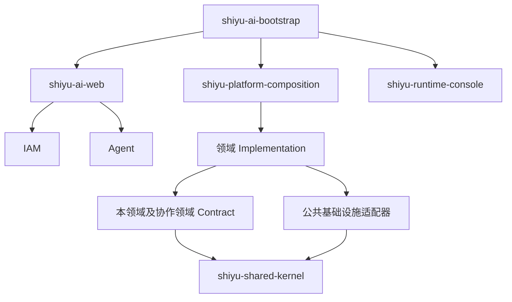

# 后端架构与代码静态审查

**审查日期：** 2026-10-22

**审查范围：** `shiyu-ai` 后端 Maven reactor 及其生产源码、架构规则和相关测试源码。

**基线提交：** `a49c0c61`
**初次审查方法：** 静态源码与依赖审查；当时未修改代码，未运行构建、测试或服务。后续整改与验证记录见“整改复核”。

## 结论摘要

后端采用模块化单体，平台领域以 Contract 和 Implementation 分层，业务由启动模块装配，公共基础设施提供 Web、持久化、线程、存储和向量能力。对 POM 依赖及 Java import 的静态扫描未发现模块依赖环、跨领域 Implementation 直接引用或 Contract 引入架构规则所禁止的框架依赖。

本轮确认 **3 项 P1、6 项 P2**。优先关注生成取消与配额生命周期、模型故障状态恢复，以及检索和考试历史在数据增长后的资源成本。没有足够证据支持 P0 级结论。后续真实 PostgreSQL 冒烟另发现 **1 项 P3 运维提示问题**。

**整改复核：** 3 项 P1 与 6 项 P2 均已按当前支持的单实例运行方式完成代码整改和定向测试。生成取消、超时回收和模型熔断均覆盖了本地执行路径。配额、路由健康和索引协调仍含进程内状态；部署手册明确指出水平扩展需先完成存储改造，因此多实例运行仍不受支持。客户端断开测试不能证明真实供应商停止计算或计费。具体验证边界见下文。

## 架构与依赖方向

Maven reactor 包含根 POM 和 31 个子模块。生产代码共 1,276 个 Java 文件，测试源码共 343 个 Java 文件。以下依赖图概括主要边界，不展示每个 Maven 依赖：



- `shiyu-ai-bootstrap` 是应用启动入口；`shiyu-platform-composition` 负责平台装配和跨领域桥接。
- IAM、Agent、Conversation、Model、Knowledge、Memory、Tooling、Governance 和 Education 等业务实现经 Contract 协作。
- Shared Kernel 承载租户、主体、错误和事件等跨领域类型；基础设施模块提供数据库、Web、文件、向量、线程等技术适配。
- `shiyu-architecture-tests` 中的 ArchUnit 规则约束领域实现依赖、Contract 框架依赖、租户上下文及持久化边界。本次只阅读了这些规则源码，未执行其测试。

## 核心业务链路

```text
HTTP 认证与租户解析
  → ActorContext / TenantScope
  → Conversation 组装提示词并预留配额
  → GenerationRun 与 Runtime 记录
  → Model 路由及流式生成
  → 事件投影、回复持久化、配额结算和用量记录
```

- **认证与租户：** HTTP 认证适配器解析用户和当前租户；应用服务接收显式 `ActorContext`，租户持久化适配器通过 `TenantScope` 限定数据范围。
- **Agent 与工具：** Agent Runtime 执行图节点、记录检查点和运行事件；高风险工具调用绑定审批信息，再由工具服务执行。
- **Knowledge：** 文档经过注册、审核、发布和版本更新，随后构建全文与向量索引；检索按关键词、向量或混合分数返回候选。
- **Memory：** 来源事件写入后由后台任务巩固为实体和关系；召回组合语义候选、文本候选及图关系，并记录检索轨迹。
- **Education：** 考试开始时建立答题快照；答题保存、提交、超时结算通过状态检查和事务处理。

## 风险与优化建议

成本估计：低为局部调整；中为跨组件调整并补充回归场景；高为持久化或分布式设计调整。P2（条件性）表示风险取决于部署形态。

| 优先级 | 源码证据 | 触发条件与影响 | 建议 | 成本 |
| --- | --- | --- | --- | --- |
| **P1** | [GenerationController.java](../../modules/domains/conversation/shiyu-conversation-implementation/src/main/java/com/shiyu/ai/conversation/implementation/web/controller/GenerationController.java)；[GenerationRunner.java](../../modules/domains/conversation/shiyu-conversation-implementation/src/main/java/com/shiyu/ai/conversation/implementation/application/GenerationRunner.java) | 取消接口将持久化任务置为终态并释放配额，但 Runner 没有保留模型订阅的 Disposable 并将取消传给上游。Provider 仍可能继续生成和消耗资源，使配额记录低估实际并发。 | 保存并管理订阅句柄，将取消传至模型 Provider；定义取消时已产生用量的结算规则。 | 中 |
| **P1** | [JdbcGenerationRepository.java](../../modules/domains/conversation/shiyu-conversation-implementation/src/main/java/com/shiyu/ai/conversation/implementation/infrastructure/persistence/repository/JdbcGenerationRepository.java)；[QuotaGenerationAdmission.java](../../modules/applications/shiyu-platform-composition/src/main/java/com/shiyu/ai/composition/integration/governance/QuotaGenerationAdmission.java) | 超时回收可把仍在本进程中执行的 GenerationRun 标记失败；该路径没有通知内存配额预留器释放预留。后续 Provider 回调发现任务已终结后退出，租户的并发额度可能持续被占用。 | 将超时纳入统一终结流程，幂等释放预留，并补充预留失配回收。 | 中 |
| **P1** | [ModelRouter.java](../../modules/domains/model/shiyu-model-implementation/src/main/java/com/shiyu/ai/model/implementation/infrastructure/gateway/service/ModelRouter.java)；[ChatEngineImpl.java](../../modules/domains/model/shiyu-model-implementation/src/main/java/com/shiyu/ai/model/implementation/infrastructure/chat/impl/ChatEngineImpl.java) | 模型连续失败达到阈值后会被候选过滤；读取源码未发现成功时重置失败计数或定时恢复的路径。健康状态按 Provider/Model 存在单例内存中，一个租户的故障也会影响使用同一模型的其他租户。 | 为健康状态设置恢复和探测策略，并评估是否应按凭据或租户隔离故障影响。 | 中 |
| **P2** | [ModelGatewayController.java](../../modules/domains/model/shiyu-model-implementation/src/main/java/com/shiyu/ai/model/implementation/web/ModelGatewayController.java)；[ChatEngineImpl.java](../../modules/domains/model/shiyu-model-implementation/src/main/java/com/shiyu/ai/model/implementation/infrastructure/chat/impl/ChatEngineImpl.java) | 路由接口保存 `timeoutMs` 和 `maxTokens`，但路由执行路径未使用这两个字段；操作者配置的时限和 Token 上限未体现在执行约束中。 | 将策略值应用到 Provider 调用，明确每项限制所约束的阶段。 | 中 |
| **P2** | [MagmaMemoryService.java](../../modules/domains/memory/shiyu-memory-implementation/src/main/java/com/shiyu/ai/memory/implementation/domain/magma/service/MagmaMemoryService.java)；[MemoryQuery.java](../../modules/domains/memory/shiyu-memory-contract/src/main/java/com/shiyu/ai/memory/contract/model/MemoryQuery.java) | `maxTokens` 在图扩展时约束新增邻居，但初始语义和关键词 anchors 先全部进入候选集合。初始命中内容较长时，返回结果可能已超过预算。 | 对初始 anchors 和扩展节点统一应用 Token 预算。 | 低—中 |
| **P2** | [EnterpriseDocumentServiceImpl.java](../../modules/domains/knowledge/shiyu-knowledge-implementation/src/main/java/com/shiyu/ai/knowledge/implementation/application/service/EnterpriseDocumentServiceImpl.java)；[EmbeddedIndexRegistry.java](../../modules/domains/knowledge/shiyu-knowledge-implementation/src/main/java/com/shiyu/ai/knowledge/implementation/infrastructure/index/adapter/EmbeddedIndexRegistry.java) | 文档发布提交后同步调用全量索引重建；重建方法使用实例级 `synchronized`，不同空间也会互相等待。提交后的重建失败没有由当前调用链持久化重试。 | 发布后记录可重试的索引任务，并按空间协调重建。 | 中—高 |
| **P2** | [EmbeddedIndexRegistry.java](../../modules/domains/knowledge/shiyu-knowledge-implementation/src/main/java/com/shiyu/ai/knowledge/implementation/infrastructure/index/adapter/EmbeddedIndexRegistry.java) | 混合检索在合并候选时调用 `findBySpace` 并读取整个知识空间的切片，再按命中 ID 取内容。数据量增长时，小 `topK` 查询仍会承担全空间读取和内存开销。 | 按候选 chunk ID 批量加载需要的切片。 | 低—中 |
| **P2** | [ExamTakingService.java](../../modules/business/education/shiyu-education-implementation/src/main/java/com/shiyu/ai/education/implementation/application/ExamTakingService.java)；[ExamTakingRepositoryImpl.java](../../modules/business/education/shiyu-education-implementation/src/main/java/com/shiyu/ai/education/implementation/persistence/repository/ExamTakingRepositoryImpl.java) | 历史查询先读取学生所有作答，再逐条查询考试并处理过期记录，最后在内存中分页；查询开销随完整历史增长。 | 在 Repository 层实现数据库分页，并批量读取关联考试。 | 中 |
| **P2（条件性）** | [MagmaConsolidationWorker.java](../../modules/domains/memory/shiyu-memory-implementation/src/main/java/com/shiyu/ai/memory/implementation/persistence/service/MagmaConsolidationWorker.java)；[H2 Memory baseline](../../modules/domains/memory/shiyu-memory-implementation/src/main/resources/db/baseline/h2/schema/memory/12_memory_magma.sql) | Worker 租约固定 60 秒，完成或失败更新只按 Job ID 定位；若处理超过租期，旧 Worker 与接管者可能同时写入。H2 基线中关系边仅以随机 ID 为主键，先查后插不能单独保证跨实例幂等。 | 增加租约 owner/token 并在状态更新时校验；为关系边使用数据库幂等约束或等价 upsert。 | 中 |
| **P3** | [ApplicationStartupListener.java](../../modules/applications/shiyu-ai-bootstrap/src/main/java/com/shiyu/ai/bootstrap/lifecycle/ApplicationStartupListener.java) | 启动监听器无条件打印 H2 控制台地址。实际使用 `postgresql` profile 时仍会输出该地址，容易被误认为应用回退到了 H2；本次实测没有发生回退。 | 根据 `shiyu.infrastructure.database.provider` 条件化输出，或在非 H2 profile 下省略该行。 | 低 |

## 整改复核（2026-10-22）

以下状态针对当前工作区的后续改动；实现目前未提交、未推送。测试结果只代表列出的定向测试。

| 原发现 | 当前状态 | 源码改动与验证边界 |
| --- | --- | --- |
| P1 生成取消没有停止 Provider | **当前支持的单实例路径已修复** | `GenerationRunner` 保存并 dispose 活跃 Reactor 订阅，取消接口及超时回收都会通知当前实例的 Runner；Model 为 OpenAI 兼容和 Ollama 流式适配器加入可取消的 JDK HTTP 客户端，DeepSeek 中断流读取并关闭响应体。Model 定向测试使用本地 SSE 服务验证 OpenAI 兼容和 DeepSeek 流取消会断开 HTTP 连接。多实例运行不受支持；真实供应商收到断开后是否停止计算或计费未验证。 |
| P1 超时回收未释放配额预留 | **当前支持的单实例路径已修复** | 新增回收调度器；Repository 只返回通过状态 CAS 成功回收的记录，调度器先取消本地 Provider 流，再释放配额。`QuotaGenerationAdmission` 在配额释放/结算成功后才移除本地预留，并串行处理同一 run 的并发终结；新增释放异常后重试测试。多实例运行不受支持，跨副本配额句柄共享未实现。 |
| P1 模型失败状态不恢复且跨租户影响 | **当前支持的单实例路由已修复** | ModelRouter 将路由熔断状态按租户隔离；连续失败后冷却 30 秒允许单个探测，成功会清除失败状态。Model 定向测试验证阈值、租户隔离和恢复。路由健康仍存于进程内存，管理接口展示的全局 Provider 健康值不能代表每个租户；多实例运行不受支持。 |
| P2 模型路由 timeout/maxTokens 未生效 | **已在应用调用边界应用** | 路由执行读取 `timeoutMs` 并传入同步超时或流超时，同时按策略、Provider 上限和请求上限计算输出 Token 上限。Model 定向测试通过。应用超时或取消订阅不保证 Provider 端请求一定终止，需按 Provider 适配器验证。 |
| P2 Memory 初始候选可超过 Token 预算 | **已修复** | 初始 anchors 与后续图扩展使用同一预算边界，超预算候选不会进入结果；Memory 定向测试通过。Token 数仍由项目的估算方法计算。 |
| P2 Knowledge 发布后同步重建索引、失败无持久重试 | **当前支持的单实例路径已修复** | 发布、归档、回滚和删除事务写入 `INDEX_REBUILD` 持久任务；Worker 使用状态和版本 CAS 领取任务，支持心跳、超时恢复和有界重试；索引重建锁按租户与空间隔离。Knowledge 定向测试通过。索引文件仍为本地资源，水平扩展前需改为共享索引存储并验证任务协调。 |
| P2 Knowledge 混合检索全空间读取 chunks | **已修复** | 混合检索按候选 ID 批量读取，并同时限定租户、空间和未删除记录；Knowledge 定向测试通过。 |
| P2 Education 历史查询全量读取并逐条查考试 | **已修复** | Repository 在数据库分页查询中关联同租户且未删除的考试，因此结果和 total 都受关联条件约束；Service 批量读取当前页考试，并以游标批次处理到期作答。Education 定向测试通过。 |
| P2 Memory 巩固任务租约竞争及关系边重复 | **已修复** | 完成/失败更新要求任务仍为 `RUNNING`、租约值匹配且未过期；关系边 ID 基于租户和关系内容稳定生成，并通过 `JdbcDialect.upsert` 写入。Memory 定向测试通过；PostgreSQL、MySQL 和 H2 服务器均未在本轮实际运行。 |

## 数据库兼容性验证（2026-10-22）

本地验证环境为 PostgreSQL 18.6、UTF-8，数据库地址为 `localhost:5433/postgres`。连接密码按用户授权作为 `postgresql` profile 的本地默认值写入，同时保留 `SHIYU_DB_URL`、`SHIYU_DB_USERNAME`、`SHIYU_DB_PASSWORD` 覆盖能力；本报告不记录凭据。

1. 使用 [PostgreSQL schema baseline](../../scripts/database/postgresql/baseline-schema.sql) 和 [seed baseline](../../scripts/database/postgresql/baseline-seed.sql) 完成初始化。结果为 93 张 `public` 表，`common_schema_baseline.baseline_version=4`，`seed_profile=system-ai`。
2. Maven reactor 的 30 个模块全部 `SUCCESS`，全量测试 0 failures、0 errors。构建产物为 `modules/applications/shiyu-ai-bootstrap/target/shiyu-ai-bootstrap-1.0.0.jar`。
3. 使用独立临时 `APP_HOME`、`postgresql` profile 和端口 19001 启动真实 jar。日志确认 Hikari 建立 `org.postgresql.jdbc.PgConnection`，`DatabaseInitializer` 校验外部数据库基线 4（`system-ai`）和 91 张应用表；应用在 8.125 秒内启动成功，没有回退到 H2。
4. PostgreSQL `pg_stat_activity` 同时看到 10 个 `application_name=PostgreSQL JDBC Driver` 的 Hikari 连接。`GET /v3/api-docs` 返回 HTTP 200，响应 314,959 字节，OpenAPI 版本为 3.1.0。
5. 在事务内创建临时表并执行两次 `INSERT ... ON CONFLICT ... DO UPDATE`，最终为 1 行、值为 `updated`，随后 `ROLLBACK`；未在数据库留下探测表。
6. 关键种子表可查询：1 个租户、1 个用户、3 个角色、9 个模型、1 个知识空间、1 门课程、2 个会话和 4 条消息。`auth_tenant_module` 的必填值和状态值未发现异常。
7. 停止应用后，端口 19001 和 JDBC 会话均已释放；再次检查仍为 93 张表、基线 4/`system-ai`，启动没有改写基线标记或破坏已建 schema。

本机 PostgreSQL 未提供 `vector`/`pgvector` 扩展，因此本次真实数据库冒烟使用应用默认的 JVector provider，没有验证 `pgvector` provider、向量列和相似度查询。MySQL、生产 PostgreSQL、认证后的完整业务写入链路、多实例竞争及真实模型供应商也尚未验证。

## 建议的回归场景

- 取消生成后确认上游停止，并校验真实请求数、Token 用量和租户并发额度保持一致。
- 超时回收后确认同租户可以获得已释放的配额；重复终结不会重复结算或释放。
- 覆盖模型“失败—成功—失败”、冷却恢复以及不同租户共用模型时的健康隔离。
- 初始 Memory 候选超过 Token 预算时仍遵守 `maxTokens`；模型路由超时和 Token 上限确实约束调用。
- 多 Worker 接管超时任务时，旧租约持有者不能覆盖新持有者的结果，关系边不会重复。
- Knowledge 检索与 Education 历史分页在大数据量下只读取当前候选或页内数据。

## 验证范围与限制

- **初次审查已检查：** 31 个 Maven 子模块依赖、生产源码之间的模块级 Java import、架构测试规则，以及生成、Agent/工具、模型路由、Knowledge、Memory、Education 等代表性业务调用链。
- **初次静态结果：** 未发现 Maven 模块依赖环；未发现跨领域 Implementation 直接 import 或 Contract 依赖架构规则所禁止的框架包。
- **后续定向验证：** Conversation 16 项、Model 60 项、Knowledge 16 项、Education 53 项、Memory 41 项、配额释放重试 1 项测试通过，共 187 项。随后完整 Maven reactor 再次通过，30 个模块全部成功，测试 0 failures、0 errors。
- **数据库验证：** 本地 PostgreSQL 18.6 已完成基线安装、真实 profile 启动、连接池、OpenAPI、关键种子查询和事务内 upsert 冒烟。应用停止后连接归零，93 张表与基线 4/`system-ai` 保持不变。
- **未验证：** MySQL、生产 PostgreSQL、pgvector provider、认证后的完整业务链路、真实模型 Provider 请求及供应商侧是否停止计费、多实例竞争/故障恢复和真实数据规模。通用 PostgreSQL upsert 已在临时表验证；Memory 专用 Repository 仍主要依赖单元/集成测试中使用的数据库路径。原报告 findings 是源码风险判断，不代表线上事故。
- **部署边界：** [部署运维手册](../部署运维手册.md)将 H2 与本地索引标为单实例架构，并要求水平扩展前完成外部数据库、分布式缓存/会话和共享对象存储改造。当前配额预留、取消句柄、模型路由健康状态及索引协调使用进程内数据，不应直接部署为多实例服务。
- **工具可用性：** `brooks-health` 所依赖的共享规则文件在当前本机技能目录中缺失，因此本报告不使用该技能的健康评分。

## 尚未修改项

| 项目 | 状态 | 说明 |
| --- | --- | --- |
| PostgreSQL profile 下 H2 控制台提示 | 未修改 | 实测没有 H2 回退，但启动日志仍无条件打印 H2 地址，列为 P3 运维提示问题。 |
| pgvector 兼容性 | 未验证 | 本机没有安装 `vector`/`pgvector` 扩展；应用默认 JVector 路径已启动。 |
| MySQL 兼容性 | 未验证 | 当前只安装了 PostgreSQL 基线并在本地 PostgreSQL 执行。 |
| 生产 PostgreSQL | 未验证 | 未连接任何远端或生产数据库。 |
| 认证后的业务写入链路 | 未验证 | 本次没有可用的测试账号凭据；启动期基线校验和基础 SQL 已执行，但没有通过 HTTP 完成登录后的端到端写操作。 |
| 多实例与真实 Provider | 未验证 | 进程内配额、路由健康和索引协调仍按单实例边界设计；真实供应商取消与计费行为没有外部观测。 |

## 技能

初次审查使用已安装的 `karpathy-guidelines` 约束审查方式；后续修复使用 `test-driven-development` 和 `systematic-debugging`。没有为本次工作重复安装技能。
